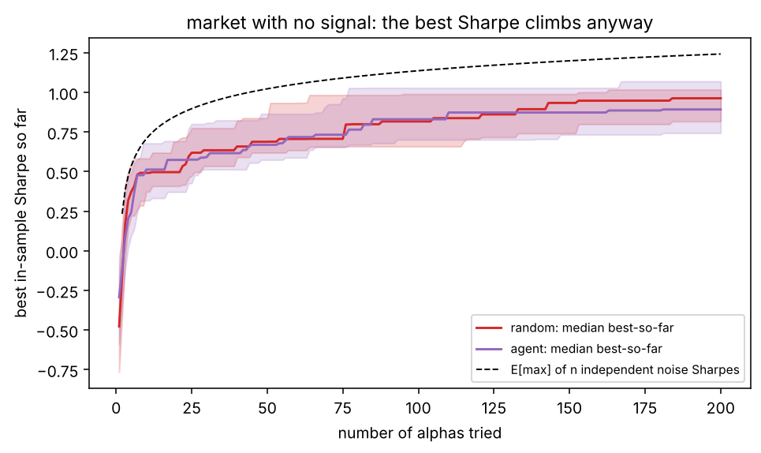
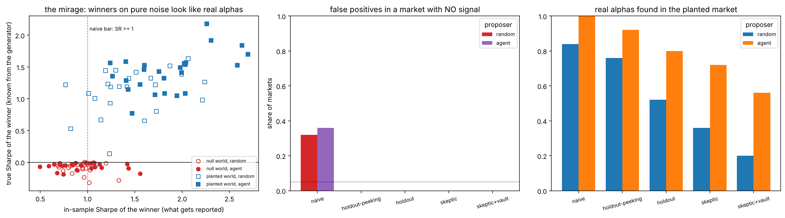
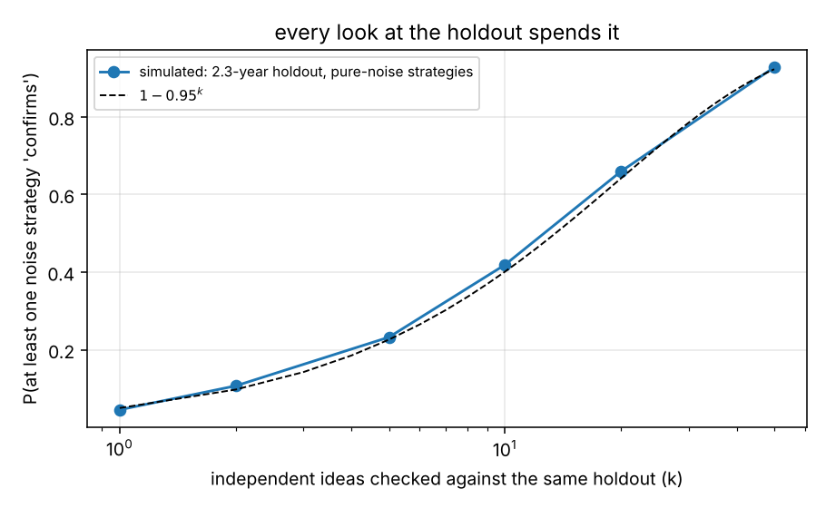

# skeptic

**A statistical conscience for AI-driven alpha research.**

Your LLM agent just found an alpha with an in-sample Sharpe of 1.6. How many ideas did it try first?
skeptic records every one of them, and then tells you whether the winner is real.

```
pip install -e .
skeptic demo --world null        # a market with NO signal: watch a "great" alpha appear, then get rejected
skeptic demo --world planted     # a market with real signals: watch them survive
skeptic audit backtests.csv      # audit backtests from anywhere: one column of returns per idea tried
skeptic verify ledger.jsonl      # check that nobody deleted the failures
```

---

## Why this exists

Generating alpha ideas used to be the bottleneck. With LLMs and genetic search it costs almost nothing, so a
single afternoon produces hundreds of backtests. The best of hundreds of backtests looks good **even when there is
nothing to find**:



*Synthetic markets with no exploitable signal at all. After 200 tries, the median best in-sample Sharpe is ~0.9,
and the curve keeps climbing. The dashed line is what 200 **independent** noise strategies would reach; real searches
fall below it because their ideas are correlated, which is why skeptic estimates an effective number of trials.*

The statistics needed to correct for this have existed for years (deflated Sharpe ratio, probability of backtest
overfitting, White's Reality Check, Hansen's SPA). In practice they are rarely applied. That is not because they are
hard to compute; it is because **nobody keeps an honest count of the trials**, and AI agents make that count
explode.

skeptic is the missing piece: a research loop that makes the count impossible to lose.

## What it does

| Component | What it guarantees |
|---|---|
| **Trial ledger** (`ledger.py`) | Every evaluated idea is written to an append-only JSONL file *before* its result is shown to anyone. Each record carries the SHA-256 of the previous one, so deleting or editing a failure breaks the chain (`skeptic verify`). Return series are stored, so any audit can be recomputed from the ledger alone. |
| **The audit** (`study.py`, `stats.py`, `overfit.py`, `bootstrap.py`) | The winner is judged against *everything that was tried*: Deflated Sharpe Ratio with an effective trial count; Probability of Backtest Overfitting (CSCV, all 12,870 splits); Hansen SPA and White Reality Check with a stationary bootstrap; Harvey–Liu haircut Sharpe; minimum backtest length. Verdict: `CANDIDATE` or `REJECT`, with reasons in plain English. |
| **The vault** | A sealed holdout period. Proposers only ever see in-sample results. The vault can be opened at any time, but every opening is recorded, and any opening after the first is reported as `CONTAMINATED`. |
| **Knowledge-cutoff guard** | An LLM trained on data up to date *C* has read papers about what worked before *C*. A vault that starts before *C* is not out-of-sample for it, so `Study(..., model_cutoff=C)` refuses it. |
| **Safe alpha language** (`dsl.py`) | Alphas are formulas like `-rank(ts_sum(returns, 5))`, parsed against a whitelist with Python's `ast`. No `eval`, no attributes, no imports: an LLM can emit anything and the worst outcome is a logged rejection. Every operator looks only backwards (tested). |
| **Proposers** (`proposers.py`) | `RandomProposer`, `TemplateProposer` (classic factor templates, a stand-in for an LLM's prior knowledge), `EvolutionaryProposer` (an adaptive agent that mutates its best in-sample performers), and `LLMProposer` (any `prompt -> text` function; Anthropic and OpenAI helpers included). |
| **Synthetic markets with ground truth** (`market.py`) | Factor model with stochastic volatility and fat tails, optionally with planted signals. Because the generator knows the exploitable drift, `true_edge` gives the **exact** Sharpe a strategy really has, with no sampling noise. That is what makes the benchmark below possible. |

## The benchmark: does it tell real alphas from mirages?

`experiments/benchmark.py`: 25 seeds × 2 kinds of market × 2 proposers = 100 independent research projects,
each trying 200 alphas on 5 years of daily data (100 stocks, 1 bp costs), with 2.3 years sealed in the vault.

- **null market**: no exploitable signal. Every discovery is false.
- **planted market**: two real signals (short-term reversal, abnormal volume) with true net Sharpe ≈ 1–1.5.

Rules for declaring a discovery from the in-sample winner:

| rule | false positives (null market, 50 projects) | real alphas found (planted), random / agent proposer |
|---|---:|---:|
| **naive**: in-sample Sharpe ≥ 1 and t ≥ 2 | **32% / 36%** | 84% / 100% |
| **holdout, peeking**: test the top 10 on the holdout until one passes | 0% / 0% | 76% / 92% |
| **holdout, used once** | 0% / 0% | 52% / 80% |
| **skeptic audit** (in-sample only) | 0% / 0% | 36% / 72% |
| **skeptic audit + vault** | 0% / 0% | 20% / 56% |



What the numbers say, without spin:

1. **The naive rule is badly fooled.** In a third of the markets with nothing to find, the winner cleared Sharpe ≥ 1
   and t ≥ 2. Those winners averaged an in-sample Sharpe of 0.93 and a *true* Sharpe of −0.08.
2. **skeptic's audit, using in-sample data only, produced zero false positives in 50 null projects** (95% upper
   bound on the rate: 5.8%), while still finding a real signal in 72% of planted markets with the adaptive agent.
   Its closest call on noise was a deflated Sharpe of 0.946 against a 0.95 gate.
3. **A clean holdout is powerful.** Used once, it also produced no false positives and had *more* power than the
   in-sample audit. If you genuinely have an untouched holdout and open it once, use it. skeptic's vault exists to
   make "once" verifiable.
4. **Why "once" matters.** In this benchmark peeking at the top 10 did not produce false positives, because the top
   10 of a search are mostly near-copies of one idea. With independent ideas the arithmetic is unforgiving
   (simulated below): 10 looks at a 2.3-year holdout let a noise strategy "confirm" 42% of the time, 50 looks 93%.
   An agent iterating against a holdout makes independent looks fast.
5. **The audit costs power.** It answers a stricter question (is the best of *all* these ideas real?) on less
   data. Use it to decide what deserves the vault, and when no trustworthy holdout exists (short histories,
   regime changes, or data the proposing model may have read about).



Other measured facts: a median of 196 recorded trials corresponded to ~19 effective independent trials; 96% of
planted-market winners had real edge (true Sharpe > 0.3).

Reproduce: `python experiments/benchmark.py 25` (resumable; ~10 min on one core), then
`python experiments/analyze.py`.

## Quickstart (Python)

```python
from skeptic import Study, EvolutionaryProposer, synthetic_market, markdown

market = synthetic_market(n_assets=100, n_days=2100, signals={"reversal": 0.015}, seed=1)
study = Study(market, research=(250, 1500), vault=(1520, 2100), cost_bps=1.0, ledger="ledger.jsonl")

study.run(EvolutionaryProposer(seed=1), n_trials=200)   # every trial -> ledger
audit = study.audit()                                   # deflate, PBO, SPA, haircut
vault = study.open_vault(audit.best_expr) if audit.verdict == "CANDIDATE" else None
print(markdown(audit, vault))
```

With an LLM (see `examples/llm_agent.py`):

```python
from skeptic import LLMProposer
from skeptic.proposers import anthropic_complete

study = Study(my_market, research=("2015-01-01", "2022-12-31"), vault=("2025-07-01", "2026-10-31"),
              model_cutoff="2025-06-30")   # vault must start after the model's training data ends
study.run(LLMProposer(anthropic_complete("claude-sonnet-5-5")), n_trials=100)
```

Your own data: `Market.from_long_csv("prices.csv")` with columns `date, asset, close, volume, ...`
(`returns` is derived from `close` if missing). Every column becomes a field usable in alphas.

Backtests from another platform: export one column of daily returns per idea, **including the ones you threw
away**, and run `skeptic audit backtests.csv --trials <total ideas tried>`. The exit code is 0 for `CANDIDATE`
and 1 for `REJECT`, so it works as a CI gate.

## How the verdict is computed

For the in-sample winner with per-period Sharpe *SR* over *T* periods:

- **Effective trials** *N*ₑ: participation ratio (Σλ)²/Σλ² of the eigenvalues of the trials' correlation matrix,
  scaled to the recorded trial count. 200 near-copies of one idea count as about 1.
- **Deflated Sharpe Ratio** (Bailey & López de Prado 2014): P(true SR > SR₀), where SR₀ is the expected maximum
  of *N*ₑ noise Sharpe ratios, √V·((1−γ)Φ⁻¹(1−1/N) + γΦ⁻¹(1−1/(Ne))), and the standard error accounts for
  skewness and kurtosis (Mertens 2002). V defaults to the null variance 1/(T−1); the empirical cross-trial variance
  and the raw trial count are reported as more conservative variants.
- **PBO** (Bailey, Borwein, López de Prado & Zhu 2017): split time into 16 blocks; over all C(16, 8) = 12,870
  in-sample/out-of-sample splits, how often does the in-sample winner finish below the out-of-sample median?
  Computed from per-block sums with two matrix products.
- **SPA / Reality Check** (Hansen 2005; White 2000): stationary bootstrap (Politis & Romano 1994) of the maximum
  studentized mean across all trials.
- **Gates**: `CANDIDATE` requires DSR ≥ 0.95, SPA p ≤ 0.05 and PBO ≤ 0.5. On the 50 null projects of the benchmark,
  SPA alone would have passed 3 and PBO alone 27; the deflated Sharpe passed none. The gates measure different
  things (selection-adjusted significance, data-snooping significance, rank stability), so all three are required.

Also included: purged and embargoed K-fold and Combinatorial Purged CV splits (`cv.py`), multiple-testing
p-value adjustments (Bonferroni, Holm, BH, BY), and minimum backtest length.

## Tests

`pytest -q` runs 38 tests in ~6 s, including:

- the Sharpe standard error and the expected maximum of N noise Sharpes against Monte Carlo;
- DSR's false-pass rate on pure noise; PBO ≈ 0.5 on noise and ≈ 0 with a real signal; SPA size and power;
- **no look-ahead**: 60+ random alphas give identical values whether or not future data exist;
- the DSL rejects 15 hostile or invalid inputs (`__import__`, attribute access, lambdas, unbounded windows, …);
- ledger tamper detection (edited and deleted records);
- the vault's one-shot rule, the knowledge-cutoff guard, and an LLM proposer fed hostile output.

## Limitations

- The benchmark uses synthetic markets so that truth is known exactly. Real markets have regime shifts, crowding and
  capacity limits that no synthetic world captures; treat the numbers as a controlled experiment, not a forecast.
- The participation ratio is one estimate of the effective number of trials; clustering-based estimates
  (López de Prado's ONC) are a natural extension.
- The backtester is deliberately simple: dollar-neutral, unit gross, one-day delay, linear costs. It is meant for
  judging *selection*, not for production sizing.
- 25 seeds bound a false-positive rate of 0/50 only to below ~6%. More seeds tighten that; the run is resumable.

## References

Bailey & López de Prado (2012, 2014); Bailey, Borwein, López de Prado & Zhu (2014, 2017); Harvey & Liu (2015);
Harvey, Liu & Zhu (2016), "…and the Cross-Section of Expected Returns"; White (2000); Hansen (2005);
Politis & Romano (1994); Lo (2002); Mertens (2002); López de Prado (2018), *Advances in Financial Machine Learning*.

License: MIT.
